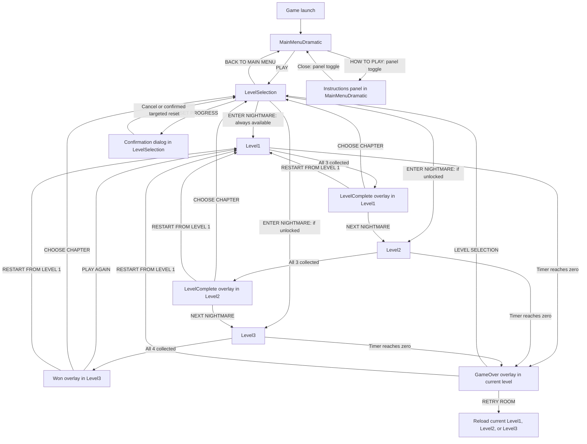

# DarkHunt — A 3D Survival Horror Game with Computer Vision-Based Flashlight Control

**Technical Project Report — B.Tech Information Technology**  
**Repository inspection date:** 5 November 2026  
**Inspected revision:** `0667041` (`skull collection made`)  
**Unity Editor version:** `6000.6.0f1`, revision `f7f8ed4d1e24`

## Evidence and Reporting Conventions

This report describes the implementation present in the inspected checkout. Its primary evidence consists of the five enabled Unity scenes, C# source files, Python source files, model and material assets, package manifests, project settings, and Git history. Existing Markdown guides provide historical context, but current source and serialized scene values take precedence wherever they disagree.

“Implemented” means that the relevant code, component configuration, or asset is present. “Statically verified” means that a repository inspection or read-only check supports the statement. Neither expression implies a successful Unity Play mode session, a measured performance result, or a completed user evaluation. Runtime-dependent behavior is explicitly identified as requiring manual validation.

Only `REPORT.md` is created for this documentation task. No scene, script, model, material, setting, dependency, or saved preference is changed.

## Contents

1. [Abstract](#1-abstract)
2. [Introduction](#2-introduction)
3. [Technology Stack](#3-technology-stack)
4. [System Requirements](#4-system-requirements)
5. [System Architecture](#5-system-architecture)
6. [Game Modules](#6-game-modules)
7. [Computer Vision Implementation](#7-computer-vision-implementation)
8. [Gameplay Mechanics](#8-gameplay-mechanics)
9. [Level Design](#9-level-design)
10. [User Interface](#10-user-interface)
11. [Database and Data Persistence](#11-database-and-data-persistence)
12. [Project Directory Structure](#12-project-directory-structure)
13. [Algorithms](#13-algorithms)
14. [Development Methodology](#14-development-methodology)
15. [Testing and Validation](#15-testing-and-validation)
16. [Challenges and Solutions](#16-challenges-and-solutions)
17. [Results and Outcomes](#17-results-and-outcomes)
18. [Future Scope](#18-future-scope)
19. [Conclusion](#19-conclusion)
20. [References](#20-references)

## 1. Abstract

DarkHunt is a first-person, single-player 3D survival-horror game in which the player searches dark indoor rooms for hidden skull collectibles before a countdown expires. The distinguishing technical feature is webcam-based head control of the viewing direction and flashlight. The player moves with conventional keyboard input while a separate Python process estimates facial orientation and communicates yaw and pitch to Unity over a local UDP connection. This division demonstrates the integration of a computer vision application with an interactive real-time game.

The Unity implementation uses Editor version `6000.6.0f1`, C# component scripts, CharacterController-based movement, physics-assisted interaction, and the Universal Render Pipeline. The Python implementation uses OpenCV for webcam capture and pose estimation, MediaPipe Face Landmarker for facial landmark detection, and NumPy for numerical operations. Six landmark correspondences are supplied to OpenCV's iterative perspective-n-point solver. Estimated yaw and pitch are calibrated against a neutral pose, smoothed, passed through a soft dead zone, constrained to comfortable angular limits, and transmitted as comma-separated values to `127.0.0.1:5005`.

The three implemented levels provide 60, 45, and 40 seconds to collect three, three, and four objects respectively. Level 1 introduces stationary obstacles. Levels 2 and 3 introduce moving crates and barriers with five-second collision penalties and two-second cooldowns. A shared game-state manager controls collection totals, time limits, successful completion, failure, and transitions. A separate progress manager stores unlocked chapters and independent best completion times through Unity PlayerPrefs. Completion time includes collision penalties because it is calculated from the starting countdown minus the remaining countdown.

The interface combines a Canvas-based main menu and instructions panel with immediate-mode gameplay, chapter-selection, and results screens. Chapter cards and successful-completion panels use a shared near-black, crimson, and bone-white horror treatment. Collectibles retain their gameplay roots and spherical interaction colliders while displaying an imported skull model and small red eye elements.

Repository analysis confirms these structural features and selected algorithmic properties. It does not establish measured tracking accuracy, latency, achieved frame rate, player comfort, level balance, or successful end-to-end operation on a particular machine. These remain subjects for controlled runtime testing.

## 2. Introduction

### 2.1 Project Background

Conventional first-person games generally use a mouse or controller to direct the view. Computer vision provides an alternative input channel by estimating a player's physical head orientation from ordinary camera images. DarkHunt applies this technique to a restricted-visibility search game, where controlling a flashlight is central to locating objects and avoiding obstacles.

The inspected game builds tension through darkness, limited search time, hidden collectibles, and moving barriers. Its survival condition is completion before time expires. The current source does not implement an enemy combat system, health points, or enemy pursuit; these should not be assumed merely from the survival-horror classification.

### 2.2 Motivation

The project explores whether a commodity webcam and a separate computer vision process can provide a usable directional input for a Unity game. It also provides a practical integration exercise involving image processing, pose estimation, asynchronous communication, frame-based control, physics, scene management, and local persistence.

The implementation demonstrates that locomotion and visual exploration can be assigned to different input channels: keyboard and mouse control remain available, while head orientation contributes to the first-person view and flashlight direction. Claims that this arrangement improves accessibility or immersion would require an empirical user study; the repository does not provide one.

### 2.3 Problem Statement

The engineering problem is to convert noisy, camera-derived facial measurements into bounded and sufficiently stable game-view rotations while maintaining a functioning timed collection game. The vision pipeline must operate outside Unity, exchange data without blocking the rendering loop, and tolerate ordinary webcam and detection failures. The game must also maintain consistent collision, interaction, scoring, and scene-transition behavior across multiple levels.

### 2.4 Objectives

| Objective | Repository implementation |
|---|---|
| Estimate head orientation with an ordinary webcam | `ComputerVision/udp_sender.py`, MediaPipe landmarks, OpenCV `solvePnP` |
| Connect Python and Unity | UTF-8 yaw/pitch datagrams and `UDPReceiver.cs` |
| Control the first-person view and flashlight | `HeadFlashlight.cs` and the Player → Camera → Flashlight hierarchy |
| Support movement and explicit collection | `PlayerMove.cs`, `PlayerInteract.cs`, `Collectible.cs` |
| Provide increasingly demanding search rooms | `Level1.unity`, `Level2.unity`, `Level3.unity` |
| Apply countdown and collision constraints | `GameManager.cs`, `MovingObstacle.cs`, `ObstaclePenalty.cs` |
| Support replay, unlocking, and best times | `LevelProgress.cs` and `LevelSelectionMenu.cs` |
| Provide coherent horror-themed presentation | `DarkHuntHUD.cs`, `DarkHuntUITheme.cs`, `DarkHuntChapterTheme.cs`, menu artwork |

### 2.5 Scope

The implemented scope is a local, three-level desktop game and a separately launched Python head tracker. It includes local saved progression, chapter selection, replay, failure recovery, and confirmed progress reset. It does not include multiplayer, remote accounts, a server-based leaderboard, automatic launch of the Python process, a traditional database, or verified deployment across multiple operating systems.

## 3. Technology Stack

### 3.1 Core Technologies

| Technology | Version or evidence | Purpose in DarkHunt |
|---|---|---|
| Unity Editor | `6000.6.0f1`, `ProjectSettings/ProjectVersion.txt` | Scene authoring, execution lifecycle, rendering, physics, input, and builds |
| C# and UnityEngine APIs | `Assets/Scripts/` and `Assets/UI/Scripts/` | Gameplay components, UI presentation, networking, and persistence |
| Universal Render Pipeline | `17.6.0`, `Packages/manifest.json` | Lighting, shadows, compatible materials, and volume effects |
| Python | Local `.venv/pyvenv.cfg` records `3.12.10` | Independent webcam and head-pose application |
| OpenCV | `opencv-python` in `requirements.txt` | Camera capture, color conversion, pose solving, overlays, and camera preview |
| MediaPipe Tasks | `mediapipe` in `requirements.txt` | Face Landmarker inference using the bundled task model |
| NumPy | `numpy` in `requirements.txt` | Landmark arrays, model coordinates, clipping, and dead-zone arithmetic |
| UDP sockets | Python `socket`; C# `System.Net.Sockets.UdpClient` | Local transmission of yaw and pitch |
| Unity UI/uGUI | `com.unity.ugui` `2.6.0` | Main-menu Canvas, Images, Buttons, scaler, and event system |
| TextMesh Pro | Existing font assets, `TMPro` references, and scene components | Text support for menu assets and builder utilities |
| Unity IMGUI | `OnGUI`, `GUI`, and `GUIStyle` calls | Runtime HUD, chapter selection, results, and reset confirmation |
| Git and GitHub | `.git/`, history, configured `origin` | Source versioning and remote repository hosting |
| Git LFS configuration | `.gitattributes` | Binary asset tracking rules, including model and image formats |

The configured Git remote is `https://github.com/Dhaliyanoushad/DarkHunt.git`. This is the remote verified in the current checkout; older descriptions of the project may use a different repository name.

### 3.2 Python Dependency Reproducibility

`ComputerVision/requirements.txt` declares only:

```text
opencv-python
mediapipe
numpy
```

It does not pin versions. The inspected local virtual environment contains distribution metadata for MediaPipe `1.1.0`, NumPy `2.5.3`, and both OpenCV Python distributions `5.0.0.93`. These are observations of local installation metadata, not a dependency lock or proof that every installed combination has passed integration testing. The requirements file does not request the additional OpenCV contrib distribution.

### 3.3 Development Tools and Supporting Packages

The `.vscode/` configuration recommends Visual Studio Tools for Unity, provides an “Attach to Unity” debugger configuration, and selects `DarkHunt.slnx` as the default solution. Unity generates the C# project files used by external editors. The manifest also includes Rider and Visual Studio integrations, Input System `1.20.0`, Test Framework `1.8.0`, Timeline `6.6.0`, and other editor/template packages.

A package's presence does not establish its use as a game feature. The inspected movement and interaction scripts use the classic `UnityEngine.Input` API. The project enables both input systems through `activeInputHandler: 2`. No enemy behavior should be inferred from the navigation package, and no animation sequence should be inferred solely from the Timeline package.

## 4. System Requirements

### 4.1 Hardware and Operating Conditions

| Requirement | Supported statement |
|---|---|
| Computer | Must run Unity 6.6 or the resulting desktop build and the Python vision process concurrently |
| Graphics hardware | Must support the project's URP rendering path; no benchmark-derived minimum GPU is recorded |
| Webcam | Required for actual head tracking; the sender opens camera index `0` |
| Keyboard and pointing device | Needed for movement, turning, interaction, and UI operation |
| Physical face illumination | The camera needs a detectable face even though the virtual room is dark |
| Display | A desktop display; chapter and victory UI fit a 1600×900 logical artboard into the viewport |
| Processor and memory | No measured minimum CPU specification or RAM requirement is established in the repository |
| Local networking | UDP port `5005` must be available to the Unity receiver |

The source requests `Application.targetFrameRate = 60`, but this is a target, not evidence that the game achieves 60 frames per second. Performance depends on simultaneous rendering, webcam acquisition, inference, pose estimation, and available hardware.

### 4.2 Software Requirements

| Component | Requirement and qualification |
|---|---|
| Operating system | Windows is the evidenced development environment; the README describes Windows 10/11 use. Current cross-platform runtime validation is not supplied |
| Unity | Editor `6000.6.0f1` is the version recorded by the project |
| Python | The local environment records Python `3.12.10`; the README recommends the Python 3.12 family |
| Python libraries | OpenCV, MediaPipe, and NumPy as declared in `ComputerVision/requirements.txt` |
| Vision model | `ComputerVision/face_landmarker.task`, present as a binary model asset |
| Development utilities | Unity Hub/Editor and a C# editor for development; Git and appropriate LFS support for a source checkout |

No exact cross-platform Python support matrix is locked by the repository. Library wheel availability and webcam permissions must be checked for a proposed target environment. A mobile-named quality profile is not evidence of a tested mobile game port. Likewise, the presence of browser-related default settings is not evidence that threaded UDP reception and the separate Python process work in a browser build.

### 4.3 Execution Preconditions

The Python sender resolves `face_landmarker.task` relative to its working directory. Running it from `ComputerVision/` therefore matches the current implementation. Unity and the sender must use the same port. The diagnostic Python receiver also binds port `5005` and must not run as a competing receiver while Unity is expected to own that endpoint.

Keyboard focus matters: calibration key `C` and quit key `Q` are read by the OpenCV preview window, while WASD, `F`, mouse turning, and `Q/E` turning are read by Unity. There is no implemented Unity-side calibration key in the current checkout.

## 5. System Architecture

### 5.1 Architectural Overview

DarkHunt consists of two cooperating local processes. Python owns the camera and computer vision pipeline. Unity owns the virtual world, game state, interactions, rendering, and saved progress. UDP is the boundary between them; Python does not directly manipulate Unity objects.

```mermaid
flowchart LR
    W[Webcam: camera index 0] --> P[Python process: udp_sender.py]
    P --> O[OpenCV capture and BGR-to-RGB conversion]
    O --> M[MediaPipe Face Landmarker]
    M --> H[Head movement processing: solvePnP, calibration, smoothing, dead zone]
    H --> C[UTF-8 yaw,pitch datagram over UDP to 127.0.0.1:5005]
    C --> R[Unity UDPReceiver background thread]
    R --> U[Main-thread Update copies latest values]
    U --> F[HeadFlashlight camera/body rotation]
    F --> L[Child spotlight follows the first-person view]
```



### 5.2 Unity Component Relationships

| Component | Principal collaborators | Responsibility boundary |
|---|---|---|
| `UDPReceiver` | `HeadFlashlight` static input values | Receives and publishes orientation samples |
| `HeadFlashlight` | Camera Transform, Light, `PlayerMove` | Smooths and distributes view/body orientation |
| `PlayerMove` | CharacterController, `GameManager` | Locomotion, turning, gravity, and cursor state |
| `PlayerInteract` | Camera, colliders, `Collectible`, `GameManager` | Selects a reachable object and handles `F` |
| `Collectible` | `GameManager` | Rotates the object, guards collection, increments progress, destroys the object |
| `MovingObstacle` | Rigidbody, `GameManager` | Moves a hazard along its configured path |
| `ObstaclePenalty` | Player hierarchy, `GameManager` | Filters contact and applies cooldown-controlled penalties |
| `GameManager` | Collectibles, `LevelProgress`, SceneManager | Owns the active run's state and timer |
| `LevelProgress` | PlayerPrefs | Owns saved unlocks and best times |
| UI components | Existing manager methods and read-only values | Draw information and invoke navigation/reset handlers |

### 5.3 Threading and Lifecycle

`UDPReceiver.Start()` binds a `UdpClient`, enables background execution, and starts a background `Thread`. Its receive loop blocks on incoming packets rather than blocking Unity's main rendering loop. The thread writes volatile yaw, pitch, and packet-count fields. `Update()` copies the latest orientation into `HeadFlashlight.yaw` and `HeadFlashlight.pitch`.

On destruction, the receiver clears its running flag and closes the socket. Exceptions are logged only while the receiver is still intended to run. There is no explicit thread join, packet timestamp, sequence number, or connection-state machine. Individual volatile fields do not constitute an atomic two-angle packet object.

## 6. Game Modules

### 6.1 Main Menu

The launch scene is [`Assets/UI/Scenes/MainMenuDramatic.unity`](Assets/UI/Scenes/MainMenuDramatic.unity). It contains a Canvas, scene camera, event system, artwork, PLAY and HOW TO PLAY buttons, and an initially inactive instructions panel. The Canvas scaler uses a reference resolution of 1920×1080.

[`MenuScreenSwitcher.cs`](Assets/UI/Scripts/MenuScreenSwitcher.cs) handles PLAY with a loading guard, restores normal time scale, and loads `LevelProgress.SelectionScene`, which is `LevelSelection`. The serialized PLAY button points to this method. Its existing panel-switch methods provide the instructions interaction.

The scene attaches `DarkHuntMenuAtmosphere`. Although its class supports artwork drift, the saved scene sets `driftAmount` and `driftSpeed` to zero, has no assigned tint overlay, and configures a 1.8-second CanvasGroup fade. The report therefore does not treat all effects available in the class as visibly active in this scene.

### 6.2 How to Play

`MenuScreenSwitcher.OpenHowToPlay()` disables the main artwork object and enables `howToPlayScreen`. `BackToMenu()` reverses those active states. The close button is serialized to call `BackToMenu`; no scene transition is involved.

The instructions panel uses the sprite in `Assets/UI/Artwork/1x.png`. The artwork describes movement, head-directed flashlight use, `F` collection, and finishing before time expires. Its broad movement wording groups Q/E with WASD, while `PlayerMove.cs` establishes the more precise behavior: Q/E turn the player rather than translate it.

### 6.3 Level Selection

[`LevelSelectionMenu.cs`](Assets/Scripts/LevelSelectionMenu.cs) draws three horizontal chapter cards through `DarkHuntChapterTheme`. Every card reads its enabled state from `LevelProgress.IsUnlocked(level)` and its score label from `BestTimeLabel(level)`.

`PlayLevel(level)` enforces locking independently of the drawing state. It rejects requests while loading, during reset confirmation, or for locked levels. A valid request resets the transient run total, restores time scale, and loads the corresponding level name. BACK TO MAIN MENU loads `MainMenuDramatic`. Reset is a separate confirmation flow.

### 6.4 Player Controller

[`PlayerMove.cs`](Assets/Scripts/PlayerMove.cs) requires a CharacterController and reads the Horizontal and Vertical axes. The serialized movement speed is `3`. Mouse turning is enabled with sensitivity `2`; Q/E turning is `90` degrees per second. The controller accumulates vertical velocity using gravity `-9.81` and applies a small downward grounded velocity of `-2` before further integration.

The player's yaw is its conventional accumulated turn plus `HeadFlashlight.bodyYaw`. Movement is calculated from `transform.right` and `transform.forward`; therefore head yaw influences walking direction when the head-to-body option is enabled. Locomotion returns early when the manager is not in `Playing` state. There is no jump, sprint, stamina, or health system in this script.

### 6.5 Flashlight Controller

[`HeadFlashlight.cs`](Assets/Scripts/HeadFlashlight.cs) reads the most recent yaw and pitch, optionally reverses their signs, clamps them to ±70° and ±35°, and interpolates toward the targets. All three level scenes set smoothing to `12`, enable `headTurnsBody`, disable fake input, and enable flicker.

With head-to-body control enabled, horizontal head orientation contributes to the player body and the camera receives pitch only. If that option is disabled, the camera receives both pitch and yaw. The flashlight's local rotation is reset to identity, so its parent-camera relationship makes the beam follow the view.

Flicker multiplies the captured starting intensity by a Perlin-noise-derived factor between 0.9 and 1.0. This is an implemented lighting variation, not a victory-screen animation.

### 6.6 Computer Vision Module

[`udp_sender.py`](ComputerVision/udp_sender.py) is the integrated sender. It captures a frame, obtains landmarks, estimates head pose, conditions the output, and sends it to Unity. `head_pose.py` is a standalone pose demonstration without UDP transmission. `face_landmarks.py` is a landmark visualization and simpler yaw-estimation demonstration. These are separate scripts, not successive modules imported by the integrated sender.

### 6.7 Collectible System

[`Collectible.cs`](Assets/Scripts/Collectible.cs) rotates each collectible root at `60` degrees per second. `Collect()` refuses duplicate collection and collection outside active play, notifies `GameManager.ItemCollected()`, then destroys the root object and its children.

The collectible roots retain names `Orb_1` through `Orb_4`, but their visible models are skulls. Each has an original disabled sphere renderer plus a `SkullVisual` hierarchy containing `SkullMesh`, `Eye_Left`, and `Eye_Right`. The imported mesh is `Assets/Models/Skull/skulls002.obj`. No new collider or gameplay script is attached to the eye elements.

Each root has scale `(0.4, 0.4, 0.4)` and a non-trigger SphereCollider with local radius `1.5`, giving a world-space radius of approximately `0.6` under this uniform scale. The roughly 0.4-unit visual size is consequently smaller than the interaction collider. Collection range is measured from that collider, not from the visible skull's outer surface.

`SkullBone.mat` uses a warm pale base color `(0.78, 0.72, 0.60)`, smoothness `0.18`, and zero emission. `SkullEyeEmber.mat` stores a dark-red base and emission color `(0.16, 0.001, 0.003)`. Both reference the same URP-compatible shader as the project materials. However, the current eye material's valid keyword list does not contain `_EMISSION`; a visible self-illuminated eye effect is therefore not established by its stored color alone and needs Inspector/Play mode verification.

### 6.8 Obstacle System

The principal named obstacles are `Crate_1`, `Crate_2`, and `Barrier_3`; Level 3 also has `Barrier_4`. Level 1 leaves its principal obstacles stationary. Later levels attach [`MovingObstacle.cs`](Assets/Scripts/MovingObstacle.cs), solid colliders, kinematic Rigidbodies, and separate child penalty triggers.

Movement occurs in `FixedUpdate()` through `Rigidbody.MovePosition()`, using a normalized direction and a triangular PingPong displacement. The script does not navigate around objects or respond with enemy-like decisions. Additional static crates, shelves, pillars, walls, and dividers form the room geometry.

### 6.9 Timer and Penalty System

[`GameManager.cs`](Assets/Scripts/GameManager.cs) captures `startingTime` and initializes `timeLeft` from the scene's time limit. Each active-play frame subtracts `Time.deltaTime`. Reaching zero changes the state to `GameOver`.

[`ObstaclePenalty.cs`](Assets/Scripts/ObstaclePenalty.cs) reacts to `OnTriggerEnter`, checks for a `PlayerMove` component in the contacting object's parent hierarchy, verifies active play, and enforces its own cooldown. Every configured penalty is five seconds with a two-second cooldown. Staying inside a trigger does not produce periodic deductions because there is no `OnTriggerStay` penalty loop.

Cooldowns belong to individual penalty components, not to a global player-wide cooldown. Contacts with two different hazards can therefore apply separate deductions even within the same two-second interval.

### 6.10 Level Completion System

The manager discovers the active scene's collectible count at startup instead of hardcoding a target of three. Each accepted collection increments `found`. When `found >= total`, a nonempty `nextScene` produces `LevelComplete`, while an empty destination produces `Won`.

Successful completion adds the level's found count to a transient cumulative count and calls `LevelProgress.RecordCompletion()` only when the scene contained collectibles and the required count has been reached. The end-state method pauses scaled game time and releases the cursor. It does not load the next scene automatically; the player chooses a result-screen action.

### 6.11 Winning Screen

`DarkHuntHUD.DrawVictory()` handles both intermediate chapter completion and final victory. It displays “YOU SURVIVED,” “NIGHTMARE CONQUERED,” the chapter identity, completion time, personal best, and a possible “NEW PERSONAL RECORD” indicator.

The UI records a read-only snapshot of the previous best in `Awake()`. A first completion or a strictly faster completion qualifies for the indicator. The manager remains the writer of saved scores. NEXT NIGHTMARE calls `Advance()` after intermediate completion; PLAY AGAIN calls it after final victory. The other actions call `RestartRun()` and `OpenLevelSelection()`.

### 6.12 Game Over Screen

The Game Over presentation is a separate branch of `DarkHuntHUD.DrawResult()`. It shows the chapter title and collected count, with RETRY ROOM, RESTART FROM LEVEL 1, and LEVEL SELECTION actions. Retry reloads the active scene. Losing does not call the successful-completion persistence path.

### 6.13 Level Unlocking

[`LevelProgress.cs`](Assets/Scripts/LevelProgress.cs) is the single owner of saved unlock state. It clamps the highest unlocked level to `1..3`, always permits Level 1, and unlocks the next level only after completing an already unlocked nonfinal level. Replaying an earlier chapter cannot reduce a previously earned unlock.

The manager, rather than menu navigation, triggers progression writes. Opening a later scene directly in the Editor is not equivalent to legitimately unlocking it through the menu.

### 6.14 Best Time Tracking

Best times are independent per chapter and lower values are better. The score is `max(0, startingTime - timeLeft)`, so penalties increase the recorded completion time. A first valid completion establishes a best; a strictly faster result replaces it. Equal and slower results do not replace it. Labels show two decimal places or `BEST: --` when no valid value exists.

### 6.15 Progress Reset

RESET PROGRESS opens a confirmation panel. Cancellation preserves all values. Confirmation calls `ResetSavedProgress()`, resets the transient run total, and closes the dialog. The progress manager deletes only its unlock key and three best-time keys, calls `PlayerPrefs.Save()`, and leaves unrelated preferences untouched. Immediate-mode drawing reads the resulting values on subsequent GUI calls, allowing the cards to refresh without loading another scene.

## 7. Computer Vision Implementation

### 7.1 Webcam Capture and Frame Preparation

The sender constructs `cv2.VideoCapture(0)` and checks `isOpened()`. Failure prints an error and terminates. Each loop reads one frame; a failed read prints an error and exits the loop. The sender does not force a webcam resolution or acquisition frame rate.

OpenCV supplies a BGR frame. The sender converts it to RGB and wraps it in `mp.Image` with SRGB format before inference. Unlike the separate landmark demonstration, the integrated sender does not horizontally flip the frame.

### 7.2 Landmark Detection

`FaceLandmarkerOptions` uses the bundled `face_landmarker.task`, one face, and confidence thresholds of `0.5` for detection, presence, and tracking. The sender calls synchronous `detector.detect(mp_image)` without explicitly selecting an asynchronous live-stream running mode. Thus the loop is a sequence of per-frame inference calls; asynchronous camera processing should not be claimed.

Only the first detected face is used. The six selected landmark IDs are:

| Landmark ID | Role used in the sender |
|---|---|
| `1` | Nose |
| `152` | Chin |
| `263`, `33` | Eye-region correspondences |
| `291`, `61` | Mouth-corner correspondences |

Normalized landmark coordinates are converted to image coordinates as `u = landmark.x × width` and `v = landmark.y × height`. This is head-pose estimation from facial structure; it is not direct measurement of pupil-based eye gaze.

### 7.3 Pose Estimation

The sender pairs those image positions with a fixed approximate 3D face model:

```text
(0, 0, 0)
(0, -330, -65)
(-225, 170, -135)
(225, 170, -135)
(-150, -150, -125)
(150, -150, -125)
```

These are generic model coordinates, not a calibrated physical measurement of the current player. The approximate intrinsic matrix is:

```text
K = [ width      0       width/2  ]
    [   0      width    height/2  ]
    [   0        0          1     ]
```

Distortion coefficients are set to zero. `cv2.solvePnP(..., flags=cv2.SOLVEPNP_ITERATIVE)` estimates rotation and translation from the six correspondences. The rotation vector is converted through `cv2.Rodrigues`, and `cv2.RQDecomp3x3` supplies angle values. The sender uses `angles[0]` as pitch and `angles[1]` as yaw; translation is not transmitted to Unity.

OpenCV documents PnP as pose recovery from 3D-to-2D correspondences and camera parameters. DarkHunt's approximation simplifies setup but does not establish calibrated angular accuracy. See [Reference 7](#20-references).

### 7.4 Calibration and Movement Calculation

The first successfully solved face pose is automatically stored as the neutral yaw and pitch. Pressing `C` while a valid face is present replaces that neutral pose and clears the smoothing states.

For a measured angle `a` and neutral angle `c`, the sender computes:

```text
relative = ((a - c + 180) mod 360) - 180
```

Wrapping removes artificial 360° discontinuities. Here, “relative” means relative to the calibrated neutral pose. It does not mean a frame-to-frame displacement accumulated like a mouse. Returning the head to neutral makes the target approach zero; the current checkout does not implement an automatic return clutch or persistent relative aiming.

### 7.5 Smoothing and Dead Zone

The integrated sender uses exponential smoothing with `SMOOTHING = 0.35`:

```text
smooth[t] = 0.65 × smooth[t-1] + 0.35 × relative[t]
```

This coefficient is applied once per processed webcam frame. Its temporal response therefore depends on the processing rate. The soft dead zone is then:

```text
output = sign(smooth) × max(abs(smooth) - 2.0, 0)
```

The dead-zone output is not fed back into the smoothing state. Values are finally clamped to ±70° yaw and ±35° pitch. For illustration, a smoothed yaw of +5° becomes +3° after the 2° soft dead zone. This is an arithmetic example, not an accuracy measurement.

### 7.6 Communication Protocol

| Property | Implementation |
|---|---|
| Transport | UDP, IPv4 datagrams |
| Sender destination | `127.0.0.1` |
| Port | `5005` in Python and all three gameplay scenes |
| Payload | `yaw,pitch` |
| Encoding | UTF-8 |
| Formatting | Two decimal places, for example `12.50,-4.25` |
| Unity parsing | Comma split and invariant-culture floating-point parsing |
| Receiver binding | `UdpClient(port)`; endpoint receive variable accepts any sender |
| Delivery guarantees | No application-level acknowledgement, ordering, or retransmission |

There is no JSON envelope, timestamp, tracking-confidence field, calibration command, or face-lost packet. The ordinary sender uses loopback, but the receiver itself does not enforce loopback-only source filtering.

### 7.7 Unity Direction Control

Unity applies a second smoothing stage:

```text
t = 1 - exp(-smoothing × deltaTime)
currentYaw   = Lerp(currentYaw, targetYaw, t)
currentPitch = Lerp(currentPitch, targetPitch, t)
```

The level scenes use `smoothing = 12`. This stage is expressed in terms of frame duration, unlike the sender's fixed per-frame coefficient. Combined smoothing reduces abrupt variation, but also introduces response lag; the repository contains no measurement of that trade-off.

### 7.8 Integrated Pseudocode

```text
load Face Landmarker model
create UDP socket
open camera 0; terminate if unavailable
initialize calibration and smoothing state

while camera frames are available:
    capture frame
    convert BGR to RGB
    detect one face
    valid_pose = false
    if landmarks exist:
        build six 2D landmark positions
        solve PnP using fixed 3D model and approximate intrinsics
        if solver succeeds:
            valid_pose = true
            extract yaw and pitch
            if not calibrated: store current pose as neutral
            wrap angle differences relative to neutral
            smooth those differences
            apply soft dead zone
            clamp yaw and pitch
            send formatted yaw,pitch to localhost UDP port 5005
            draw diagnostic angle values
    if no valid pose: draw FACE LOST
    show preview and read one key
    if C and valid_pose: replace neutral pose and clear smoothing
    if Q: exit

release camera, detector, preview windows, and socket
```

### 7.9 Error Handling and Limitations

The main sender detects camera-open and frame-read failures, requires a successful pose before sending, displays `FACE LOST`, guards recalibration with face availability, and uses one `waitKey` call per iteration. Normal shutdown releases its resources.

However, model creation and UDP transmission are not protected by a comprehensive recovery mechanism. A missing model, inference exception, or socket error can terminate execution. There is no general `try/finally` around the entire capture loop. On face loss, Python sends no new sample and Unity continues using its last received values. There is no explicit stale-data timeout or baseline reset on reacquisition, so seamless restoration cannot be guaranteed.

The separate `head_pose.py` prototype also reads calibration variables that may not yet be assigned if `C` is pressed before a valid solved pose. It should not be treated as having all safeguards of the integrated sender.

## 8. Gameplay Mechanics

### 8.1 Controls

| Input | Implemented behavior | Input owner |
|---|---|---|
| W/A/S/D or configured Horizontal/Vertical axes | Translate the first-person player | Unity |
| Mouse X | Accumulate body turning while cursor is locked | Unity |
| Q/E | Turn left/right | Unity |
| Physical head movement | Supply bounded yaw/pitch through the vision pipeline | Python → Unity |
| F | Collect the currently selected reachable object | Unity |
| Escape | Release the cursor; does not pause the game | Unity |
| Left click in gameplay | Relock cursor when mouse turning is enabled | Unity |
| C in camera preview | Recalibrate neutral head pose | Python |
| Q in camera preview | End the tracking application | Python |

Movement constructs `right × horizontal + forward × vertical` without normalizing that combined vector. Full diagonal input can therefore have a larger magnitude than single-axis movement. This is an implementation property, not a tested balance outcome.

### 8.2 Collectible Detection and F-Key Interaction

`PlayerInteract.Start()` caches the scene's collectible colliders and resolves the view camera through an assigned reference, local camera, child camera, or `Camera.main`. All three scenes explicitly reference the player camera and configure a range of `3` units with a normal angular tolerance of `12°`.

Selection runs in `LateUpdate()`. It evaluates the angle between camera forward and each collider's center, choosing the eligible object with the smallest angle. The currently selected object receives a 3° retention margin. Reachability compares the camera-to-collider closest-point distance with the configured range and checks line of sight through `Physics.RaycastNonAlloc`.

The raycast ignores trigger colliders and accepts intersections belonging to the target collectible or player hierarchy. Other solid hits block interaction. A fixed 32-hit buffer is used; if it fills completely, the method rejects reachability conservatively.

When F is pressed, the previous frame's visible target is rechecked for range and line of sight before selection is recalculated. This reduces failed collection caused by small head movements between seeing the prompt and pressing the key. It does not guarantee collection through a new obstruction or after leaving range. The prompt reads the same `PlayerInteract.Looking` reference used for collection.

### 8.3 Collision and Time Pressure

Solid colliders constrain movement through CharacterController collision handling. Moving obstacles use separate, slightly expanded trigger colliders for penalty detection. A trigger contact from the player can subtract five seconds, subject to that obstacle's cooldown. Non-player contacts are ignored by the hierarchy check.

Countdown and penalties use scaled gameplay time. On a result screen, `Time.timeScale = 0` stops the countdown and normal time-scaled movement. The HUD uses `Time.unscaledTime` to keep penalty-feedback duration meaningful independently of scaled time.

### 8.4 Success and Failure

Success occurs when the accepted collection count reaches the discovered scene total while the manager is playing. Failure occurs when the remaining time reaches zero, either by countdown or penalty. The implementation contains no physical exit-door trigger requirement: collecting all required objects is sufficient to complete the chapter.

`Advance()` distinguishes intermediate completion, final victory, and failure. A continuous run through all three levels can accumulate ten objects. Loading a chapter from the selection menu starts a fresh transient run count without clearing permanent scores or unlocks.

## 9. Level Design

### 9.1 Comparison

Values below come from the scene-serialized components, not merely the default field values in C#.

| Property | Level 1 | Level 2 | Level 3 |
|---|---|---|---|
| Scene | `Assets/Scenes/Level1.unity` | `Assets/Scenes/Level2.unity` | `Assets/Scenes/Level3.unity` |
| Chapter | THE AWAKENING | INTO THE DARKNESS | NO ESCAPE |
| Time limit | 60 s | 45 s | 40 s |
| Required collectibles | 3 | 3 | 4 |
| Principal named obstacles | 3 stationary | 3 moving | 4 moving |
| Penalty components | 0 | 3 | 4 |
| Contact deduction | None configured | 5 s | 5 s |
| Per-obstacle cooldown | Not applicable | 2 s | 2 s |
| Nominal floor footprint | 28×24 units | 28×24 units | 32×28 units |
| Next destination | `Level2` | `Level3` | Empty; final `Won` state |

The footprint describes the floor mesh extent and wall layout; walls and furniture reduce usable clearance. These are Unity world units, conventionally treated as metres for this design, rather than surveyed physical dimensions.

### 9.2 Shared Environment

Every gameplay scene contains an enclosed room, floor, ceiling, walls, storage furnishings, and four structural pillars. There are three long storage crates in each level. Level 3 adds two static divider objects, `Divider_West` and `Divider_East`, to create additional hiding and routing constraints.

All three scenes disable the two supplementary emergency-lamp Light components, set ambient intensity to zero, remove the skybox, use near-black ambient color values, and enable fog. Their enabled flashlight is configured with intensity `120`, range `30`, outer spot angle `68°`, and inner angle `34°`. These are serialized settings, not a measured illumination guarantee. The spotlight is intended to reveal surfaces while preserving darkness elsewhere.

The PC quality profile references the PC URP asset; Mobile references its own URP asset. The PC asset supports per-pixel additional lights and soft shadows. `SampleSceneProfile.asset` configures restrained bloom with intensity `0.05`; emission color alone does not guarantee a visible bloom effect.

### 9.3 Level 1 — The Awakening

**Objective:** Locate and collect three skulls within 60 seconds. The level introduces movement, head-directed searching, and F-key interaction without moving penalty hazards.

The principal obstacles are stationary `Crate_1`, `Crate_2`, and `Barrier_3`. Their presence, together with storage furnishings, breaks direct lines of sight. Difficulty is introductory by configuration: it has the longest timer, three collectibles, and no attached penalty components. This is a design interpretation, not a measured player difficulty rating.

| Root name | Position `(x, y, z)` |
|---|---|
| `Orb_1` | `(6.8, 0.45, 6)` |
| `Orb_2` | `(-7, 0.45, -4.6)` |
| `Orb_3` | `(-8, 0.45, 8.5)` |

Collecting the third object produces `LevelComplete`, records a valid best if appropriate, and unlocks Level 2. NEXT NIGHTMARE loads Level 2.

### 9.4 Level 2 — Into the Darkness

**Objective:** Collect three skulls within 45 seconds while navigating three moving hazards. The collectible root positions match Level 1 in the inspected scenes, while the shorter timer and movement introduce additional constraints.

| Hazard | Starting position | Direction | Travel distance | `moveSpeed` |
|---|---|---|---|---|
| `Crate_1` | `(4, 0.65, 2)` | `(1, 0, 0)` | `2.5` | `2` |
| `Crate_2` | `(-5, 0.65, -2)` | `(0, 0, 1)` | `3` | `1.5` |
| `Barrier_3` | `(-7, 0.65, 6)` | `(1, 0, 0)` | `4` | `2.5` |

Each hazard has a gravity-disabled kinematic Rigidbody, a solid obstacle collider, and one child `PenaltyTrigger` with five-second deduction and two-second cooldown. Movement proceeds from the starting position to the positive configured direction and back; it is not symmetric displacement around the start.

Collecting the third object produces intermediate completion and unlocks Level 3 if Level 2 is already unlocked. NEXT NIGHTMARE loads Level 3. The present configuration does not end the full game after Level 2.

### 9.5 Level 3 — No Escape

**Objective:** Collect four skulls within 40 seconds in the larger room while avoiding four moving penalty hazards and navigating additional dividers. Its increased search count, larger footprint, and shorter time budget make it the most demanding chapter by configuration; runtime balance remains unmeasured.

| Root name | Position `(x, y, z)` |
|---|---|
| `Orb_1` | `(-8, 0.45, -4.6)` |
| `Orb_2` | `(8, 0.45, 2)` |
| `Orb_3` | `(-6, 0.45, 8.5)` |
| `Orb_4` | `(7, 0.45, 9.4)` |

| Hazard | Starting position | Direction | Travel distance | `moveSpeed` |
|---|---|---|---|---|
| `Crate_1` | `(-2, 0.7, -4)` | `(1, 0, 0)` | `3.5` | `2.4` |
| `Crate_2` | `(4.4, 0.7, 1.6)` | `(0, 0, 1)` | `3` | `2` |
| `Barrier_3` | `(-8, 0.8, 4.2)` | `(1, 0, 0)` | `3.5` | `2.8` |
| `Barrier_4` | `(0, 0.8, 8.8)` | `(1, 0, 0)` | `3` | `2.7` |

The same five-second penalty and per-obstacle two-second cooldown apply. The fourth accepted collection produces `Won` because `nextScene` is empty. The victory screen displays the accumulated total for the current run and provides the existing replay and chapter-selection actions.

## 10. User Interface

### 10.1 Interface Technologies

DarkHunt uses two Unity UI approaches. The main menu uses scene-authored uGUI components and image assets, with TextMesh Pro components also present. Its two inspected TMP text fields are empty, so visible printed menu content should not be assumed to come from dynamically generated TMP text. The chapter menu, HUD, confirmation dialog, and result panels are drawn through IMGUI.

`DarkHuntUITheme` supplies label fitting, colors, borders, panels, and hover/button drawing. `DarkHuntChapterTheme` adds static grain, doorway forms, worn edges, lock symbols, an emblem, and serif display text for chapter and victory screens. It attempts locally available Georgia, Baskerville, or Times New Roman fonts with a default UI fallback; it does not bundle a dedicated distressed display font.

### 10.2 Chapter and Victory Presentation

| Palette element | Value in `DarkHuntChapterTheme` |
|---|---|
| Near-black | `#080608` |
| Blood red | `#8B1020` |
| Dark crimson | `#3A0B13` |
| Bone white | `#DDD4C8` |

The chapter menu displays DARKHUNT, “CHOOSE YOUR NIGHTMARE,” ghostly chapter numbers, named cards, best-time labels, and ENTER NIGHTMARE buttons. Locked cards are darkened, marked LOCKED, and drawn with a lock symbol. The button is disabled and the action handler independently checks availability.

The victory panel displays completion time and saved personal best as separate values. Its decorative scratches, doorway emblem, and texture are static. The grain texture is generated once using a deterministic random seed. No victory animation is implemented by this helper.

Both screens scale a 1600×900 logical artboard uniformly using the smaller width or height ratio, then center it inside the viewport. This preserves proportions at different aspect ratios, but small-screen legibility and actual rendering still need runtime testing.

### 10.3 Gameplay HUD and Game Over

The gameplay HUD places the level name at top-left, countdown at top-center, and object count and best time at top-right. It includes a small center reticle, a conditional PRESS F TO COLLECT panel, and red penalty feedback lasting 1.5 seconds of unscaled time. The timer changes color at ten seconds or less. The current HUD draws a short decorative timer rule, not a duration-proportional progress bar.

Game Over retains its own centered dark panel and existing retry/navigation controls. Successful-completion drawing is routed to `DrawVictory()`, while the failure path remains separate.

### 10.4 Scene Navigation



Completion and failure overlays are states within gameplay scenes, not additional scene files. `EditorBuildSettings.asset` lists the enabled scenes in this order: MainMenuDramatic, LevelSelection, Level1, Level2, Level3. This establishes the launch scene for builds; pressing Play in the Editor normally starts the currently opened scene instead.

## 11. Database and Data Persistence

### 11.1 Storage Design

DarkHunt does not require a traditional database. `LevelProgress.cs` uses Unity PlayerPrefs to store a small set of local integer and floating-point values. No inspected runtime module connects progression or scores to MySQL, MongoDB, Firebase, or a remote persistence service.

Unity documents PlayerPrefs as platform-dependent local preference storage and notes that it is not encrypted. Accordingly, DarkHunt's saves are suitable for local progression but do not provide tamper-resistant competitive records. See [Reference 2](#20-references).

### 11.2 Actual Keys and Values

| Exact key | Stored type | Interpretation | Missing/invalid behavior |
|---|---|---|---|
| `DarkHunt.HighestUnlockedLevel` | Integer | Highest sequentially unlocked chapter | Defaults to 1; read is clamped to 1–3 |
| `DarkHunt.BestTime.Level1` | Float | Fastest successful penalized completion time for Level 1, in seconds | Displays `BEST: --` if missing or invalid |
| `DarkHunt.BestTime.Level2` | Float | Corresponding Level 2 best | Same validation |
| `DarkHunt.BestTime.Level3` | Float | Corresponding Level 3 best | Same validation |

`TryGetBestTime` rejects negative, NaN, and infinite saved times. It accepts zero as a valid stored value. The UI formats accepted values using invariant culture with two decimal places; the stored float is not rounded to the display precision.

### 11.3 Unlock and Score Transactions

`RecordCompletion(sceneName, completionSeconds)` first resolves a known level and rejects an invalid time. If an unlocked, nonfinal level has a locked successor, it stores the successor as the highest unlocked chapter. Independently, it writes a score if there is no valid previous best or the new time is strictly lower. `PlayerPrefs.Save()` is called when either operation changes stored data.

Unlocking is not conditional on breaking a record. For example, a player with Level 2 already unlocked and an older Level 2 best can finish it more slowly, retain that best, and still unlock Level 3. Successful replays never reduce a saved highest-unlocked value.

The normal caller is the manager's successful-completion path. `RecordCompletion` is a public method, not a security boundary: opening a locked scene directly or invoking methods through debugging can differ from normal menu-restricted play. Its unlock check prevents skipping a locked prerequisite, but the best-time write itself is not gated by `IsUnlocked(level)`.

### 11.4 Reset and Session Behavior

Reset deletes exactly the four listed keys and saves the result. Missing unlock data then reads as Level 1, leaving Levels 2 and 3 locked. It does not call `DeleteAll()` or clear unrelated preferences.

Saved bests and unlocks are designed to persist between sessions within their PlayerPrefs environment. Actual filesystem/registry persistence after closing a build must be tested separately from Editor behavior. The cumulative run-object total is a static in-memory field, not a saved key; it is reset by menu selection and first-level startup as appropriate.

### 11.5 Advantages and Limitations

The design is small, local, and independent of a database server. Centralizing it avoids duplicate unlock and score rules in individual buttons. Its limitations include editable local data, no account association or device synchronization, floating-point comparison at full stored precision, no richer save schema, and no checkpoint restoration of a partially completed room.

## 12. Project Directory Structure

The following tree presents the actual implementation-relevant structure; generated caches, metadata repetitions, and unrelated binary resources are omitted.

```text
DarkHunt/
├── Assets/
│   ├── Scenes/
│   │   ├── LevelSelection.unity
│   │   ├── Level1.unity
│   │   ├── Level2.unity
│   │   └── Level3.unity
│   ├── Scripts/
│   │   ├── Collectible.cs
│   │   ├── DarkHuntChapterTheme.cs
│   │   ├── DarkHuntHUD.cs
│   │   ├── DarkHuntMainMenuEffects.cs
│   │   ├── DarkHuntMenuButton.cs
│   │   ├── DarkHuntUITheme.cs
│   │   ├── GameManager.cs
│   │   ├── HeadFlashlight.cs
│   │   ├── LevelProgress.cs
│   │   ├── LevelSelectionMenu.cs
│   │   ├── MovingObstacle.cs
│   │   ├── ObstaclePenalty.cs
│   │   ├── PlayerInteract.cs
│   │   ├── PlayerMove.cs
│   │   └── UDPReceiver.cs
│   ├── Models/Skull/skulls002.obj
│   ├── Materials/
│   │   ├── SkullBone.mat
│   │   ├── SkullEyeEmber.mat
│   │   ├── OrbMat.mat
│   │   ├── Concrete.mat
│   │   ├── Timber.mat
│   │   ├── Steel.mat
│   │   └── other room and guide materials
│   ├── Settings/
│   │   ├── PC_RPAsset.asset
│   │   ├── PC_Renderer.asset
│   │   ├── Mobile_RPAsset.asset
│   │   ├── Mobile_Renderer.asset
│   │   ├── SampleSceneProfile.asset
│   │   └── supporting pipeline/profile assets
│   ├── UI/
│   │   ├── Artwork/
│   │   │   ├── Frame 2.png
│   │   │   ├── 1x.png
│   │   │   ├── play.png
│   │   │   ├── how to play.png
│   │   │   └── howtoplay.png
│   │   ├── Scenes/MainMenuDramatic.unity
│   │   ├── Scripts/
│   │   │   ├── MenuScreenSwitcher.cs
│   │   │   ├── DarkHuntMenuAtmosphere.cs
│   │   │   └── DarkHuntMenuHotspot.cs
│   │   ├── Editor/
│   │   │   ├── DarkHuntMainMenuBuilder.cs
│   │   │   └── DarkHuntDramaticMenuBuilder.cs
│   │   ├── Animations/
│   │   └── Prefabs/
│   ├── TextMesh Pro/
│   ├── TutorialInfo/
│   └── InputSystem_Actions.inputactions
├── ComputerVision/
│   ├── udp_sender.py
│   ├── head_pose.py
│   ├── face_landmarks.py
│   ├── udp_receiver_test.py
│   ├── web_cam_test.py
│   ├── face_landmarker.task
│   ├── requirements.txt
│   └── .venv/                       local, ignored environment
├── Packages/
│   ├── manifest.json
│   └── packages-lock.json
├── ProjectSettings/
│   ├── ProjectVersion.txt
│   ├── ProjectSettings.asset
│   ├── EditorBuildSettings.asset
│   ├── InputManager.asset
│   ├── GraphicsSettings.asset
│   └── QualitySettings.asset
├── Tests/                           cached bytecode observed; no tracked test source
├── .vscode/
├── .gitattributes
├── .gitignore
├── README.md
├── DARKHUNT_VISUALS.md
├── LEVEL_SELECTION.md
├── LEVEL3.md
└── REPORT.md
```

Unity `.meta` files associate assets with stable GUIDs and are important to scene references. The skull model is referenced by GUID and mesh subasset identifier. Collectibles are authored directly in each level scene; no collectible prefab file was found in this checkout.

The two menu builders are Editor-only generation utilities. Their source contains older template names and placeholder navigation descriptions, so regenerating a menu is not equivalent to reproducing the currently serialized MainMenuDramatic scene. Likewise, `DarkHuntMainMenuEffects` and `DarkHuntMenuButton` provide presentation behavior for generated designs but are not attached in the inspected launch scene. `DarkHuntMenuHotspot` is also not attached there; current navigation uses the existing Button components and MenuScreenSwitcher.

`Library/` and `Logs/` are generated working directories. They are not primary source modules or evidence of a packaged release. The `.gitignore` excludes Unity-generated output, virtual environments, and Python caches.

## 13. Algorithms

### 13.1 Head-Tracking Algorithm

The actual integrated sequence is landmark detection → six-point PnP → angle extraction → neutral calibration → angle wrapping → exponential filtering → soft dead zone → clipping → transmission. Its computational work is dominated by camera/inference and PnP rather than the constant-size arithmetic stages. It tracks one face and transmits two angles, not facial meshes or video frames.

### 13.2 Flashlight-Movement Algorithm

```text
targetYaw   = clamp(optionallyInvert(receivedYaw), -70, 70)
targetPitch = clamp(optionallyInvert(receivedPitch), -35, 35)
blend = 1 - exp(-12 × deltaTime)
currentYaw   = lerp(currentYaw, targetYaw, blend)
currentPitch = lerp(currentPitch, targetPitch, blend)
bodyYaw = currentYaw if headTurnsBody else 0
camera.localRotation = Euler(currentPitch, 0 if headTurnsBody else currentYaw, 0)
flashlight.localRotation = identity
```

The player adds `bodyYaw` to conventional turning. No angular velocity is integrated from a stationary nonneutral head pose; the system converges to a bounded orientation. Conversely, it also does not preserve mouse-like relative aim after the head returns to neutral.

### 13.3 Collectible-Interaction Algorithm

```text
if not active play or camera unavailable: clear selected target
if F pressed and previous selected target is still reachable:
    collect it and return
bestAngle = infinity
for each cached collectible collider:
    reject missing, disabled, or inactive collider
    calculate angle from camera forward to collider center
    use 12-degree tolerance, plus 3 degrees for previous target
    reject excessive angle or candidate worse than current best
    reject excessive closest-point distance or blocked line of sight
    remember candidate as selected target
if F pressed and target exists: collect target
```

Selection scans `n` cached targets, giving a linear candidate pass plus physics queries for eligible objects. The scenes contain only three or four targets. Dynamically spawning new collectibles after `Start()` would require reconsidering the cached-target design.

### 13.4 Countdown and Completion-Time Algorithm

```text
on level startup:
    remaining = starting = sceneTimeLimit
while state is Playing:
    remaining -= deltaTime
    if remaining <= 0:
        remaining = 0
        end as GameOver
on successful completion:
    completionTime = max(0, starting - remaining)
```

The score is a timer-derived penalized duration, not an independent wall-clock stopwatch. For example, eight seconds of Level 3 play plus one five-second deduction yields a completion time of 13 seconds if completion occurs with 27 seconds remaining. This example illustrates the formula; it is not an observed player result.

### 13.5 Moving-Obstacle and Penalty Algorithms

```text
offset = PingPong(timeSinceLevelLoad × moveSpeed, moveDistance)
targetPosition = initialPosition + normalizedDirection × offset
Rigidbody.MovePosition(targetPosition)
```

The approximate full movement cycle is `2 × moveDistance / moveSpeed` seconds for positive parameters. Invalid distance or a near-zero direction suppresses movement.

```text
on trigger enter:
    reject contact without PlayerMove in its parent hierarchy
    reject missing manager or non-Playing state
    reject if currentTime - lastAcceptedHit < cooldown
    set lastAcceptedHit to currentTime
    request a five-second deduction
```

The manager rejects nonpositive, NaN, and infinite deductions. A valid deduction clamps remaining time at zero and can end the run immediately. The component's cooldown is scaled gameplay time.

### 13.6 Level-Progression Algorithm

```text
on accepted collection:
    found += 1
    if found >= discoveredTotal:
        choose LevelComplete when nextScene is nonempty, otherwise Won
        add found to transient cumulative total
        record successful completion
        pause scaled time and expose cursor

inside progress recording:
    validate known scene and nonnegative finite time
    if current level is unlocked and has a locked successor:
        save successor as highest unlocked level
    independently evaluate the best-time update
    save preferences if any value changed
```

### 13.7 Best-Time Algorithm

```text
if no valid previous best or currentCompletionTime < previousBest:
    save currentCompletionTime under this level's key
else:
    retain previousBest
```

Strict comparison is intentional: an equal time is not a new record. Because display formatting rounds to two decimal places, two visually identical displayed times can still have different underlying float values.

## 14. Development Methodology

### 14.1 Evidence-Based Process Description

The repository supports an iterative, feature-based development account rather than proof of a formally administered Scrum or waterfall process. Git history shows successive implementation of movement and tracking, game state and collection, a second level, penalties, selection and lighting, a third level, connected menu navigation, and skull visuals.

| Date and commit | Evidence of implementation stage |
|---|---|
| 9 October 2026, `791c512` and `e796953` | Player/view integration and Python head-tracking sender |
| 13 October 2026, `209bf6f` | Game manager, original object collection, timer, and result screens |
| 21 October 2026, `a0101ce` and `d315349` | Level 2 and collision-penalty work |
| 22 October 2026, `6d3655d` | Level-selection and flashlight-related refinement |
| 23 October 2026, `b6181ed` | Third level |
| 23 October 2026, `a3c193e` | Main-menu connection |
| 23 October 2026, `0667041` | Skull collectible presentation |

These entries show repository evolution; they do not establish exact effort, team roles, sprint lengths, requirements sign-off, or a controlled experiment.

### 14.2 Integration Strategy

The source organization demonstrates separation of responsibilities. Vision can be examined through standalone webcam, landmark, and pose scripts. A simple UDP receiver provides an independent view of transmitted values. Unity then separates reception, view control, player motion, interaction, obstacles, run state, persistence, and presentation.

Scene-specific timers, positions, and hazard movement settings are serialized in scenes. Shared scripts provide the same rules across levels. The skull replacement demonstrates visual hierarchy separation: root scripts and collision behavior remain independent of the visible model.

### 14.3 Debugging Evidence

Comments and code identify several deliberate safeguards: a single OpenCV key-read operation per frame, angle wrapping, soft dead-zone separation from smoothing state, a guarded collection method, previous-frame prompt retention, conservative raycast overflow rejection, invariant-culture networking values, success-only score calls, and targeted preference reset.

Existing guides document earlier static checks and manual Editor procedures. Some descriptions are obsolete: the README still refers to SampleScene and incomplete level functionality, while older selection guides describe LevelSelection as startup and older visual notes discuss a two-level ending. The current build list, scripts, and scenes resolve those discrepancies.

## 15. Testing and Validation

### 15.1 Validation Performed for This Report

Read-only checks performed during this report task established:

- Unique serialized object IDs and resolution of local `{fileID: ...}` references in all five scene files. This is a structural reference check, not a full Unity import test or validation of every external mesh subasset.
- Agreement between the five build scene paths, their metadata GUIDs, and the required launch/progression order.
- Unique, correctly formatted GUIDs across 122 asset metadata files in the inspected checkout.
- Python AST syntax parsing for all five Python source files, without importing their capture loops or creating bytecode files.
- Eight boundary checks on the actual extracted `wrap` and `soft_dead_zone` helper functions. The isolated check used a scalar sign stand-in; it did not load MediaPipe, NumPy, or the webcam application.
- Scene extraction of timers, collectible counts, movement parameters, trigger settings, Rigidbody settings, camera references, and flashlight values.
- Source tracing of the successful-completion path, score formula, preference keys, reset implementation, navigation handlers, and UI state branches.

No Unity Play mode run, new C# compilation, dependency installation, webcam inference session, build export, or preference reset was performed for the report. Older guides state that compilation and 29 progress/GameManager checks were previously performed, but the corresponding runnable test source and complete result artifacts are not present in this checkout. Those claims are historical documentation, not newly reproduced results.

`Tests/` contains cached Python bytecode, but `git ls-files Tests` returns no tracked test source. `web_cam_test.py` and `udp_receiver_test.py` are interactive diagnostics, not assertion-based automated test suites.

### 15.2 Functional Test Matrix

| ID | Area | Procedure and expected outcome | Current evidence/status |
|---|---|---|---|
| T01 | Player movement | Use WASD, mouse, Q/E; verify solid walls block movement and result screens stop locomotion | Control logic and controller configuration verified statically; physical behavior requires Play mode |
| T02 | Webcam | Start `web_cam_test.py`; expect live frames or the documented camera-open failure | Script syntax and failure branch verified; device test pending |
| T03 | Face detection | Run sender with model present; show and remove the face | Detection options and FACE LOST branch verified; inference/lighting robustness pending |
| T04 | Head tracking | Look straight, turn, return to neutral, and recalibrate with C in the preview | Pose/smoothing logic inspected; actual angle accuracy and comfort pending |
| T05 | Angle conditioning | Test wrapping beyond ±180° and values inside/outside the 2° soft dead zone | Eight isolated helper boundary checks passed |
| T06 | Python–Unity communication | Run Unity receiver and sender; confirm changing yaw/pitch reach the view | Matching port and payload verified; end-to-end datagram reception pending |
| T07 | Tracking loss | Obscure the face, then restore it | Static review shows last-value retention; behavior and jumps require manual assessment |
| T08 | Flashlight | Sweep the view across surfaces and occluders at different distances | Light settings and hierarchy verified; brightness, shadows, and flicker pending |
| T09 | Collectible interaction | Aim at a reachable skull, observe prompt, press F once, test blocked/out-of-range cases | Selection, previous-target retention, and duplicate guard verified statically; interaction pending |
| T10 | Skull presentation | Inspect upright orientation, size, eyes, and continuous rotation in every level | Hierarchies/materials and 3/3/4 counts verified; emitted eye appearance unresolved |
| T11 | Timer | Start each chapter, observe 60/45/40 s countdown, allow expiration | Serialized limits and failure branch verified; timing in Play mode pending |
| T12 | Moving obstacles | Observe configured paths; ensure no player or furniture clipping | Script, positions, kinematic settings, and parameters verified; dynamic clearance pending |
| T13 | Penalty/cooldown | Enter one trigger, remain inside, exit/re-enter before and after 2 s; also contact another hazard | Entry-only, per-obstacle cooldown and five-second values verified; physics callbacks pending |
| T14 | Level completion | Collect exactly 3, 3, and 4 objects; check intermediate/final state and paused movement | Counts and transition conditions verified statically; complete run pending |
| T15 | Level unlocking | Begin from fresh progress; lose/quit, then win Levels 1 and 2 | Normal success-only write path verified; stored-session behavior pending |
| T16 | Best-time saving | Finish slower, equal, and faster runs; include a penalty and compare starting minus remaining | Formula and strict comparison verified; actual stored values/session reload pending |
| T17 | Reset | Cancel, then confirm; check all three bests clear, only Level 1 unlocks, unrelated settings remain | Exact targeted deletion and UI flow verified; real preference test pending |
| T18 | Scene navigation | Test PLAY, instructions open/close, each unlocked chapter, Back, retries, and result actions | Serialized button methods and build order verified; clicking and scene reloads pending |
| T19 | UI scaling | Inspect 16:9, 16:10, 4:3, and ultrawide Game views | Logical scaling formula verified; typography, clipping, and interaction pending |
| T20 | Persistence | Close/reopen a standalone build after wins and reset | Save calls present; cross-session and Editor/build separation require manual validation |

### 15.3 Recommended Manual Sequence

Use the intended launch scene, inspect instructions, and enter chapter selection. With disposable test progress, confirm reset behavior, fail an initial attempt, and then complete each chapter sequentially. Check penalties and score values before proceeding. Return to selection and replay levels to compare slower and faster records. Restart the application to verify persistence. Repeat tracking with different face illumination, neutral positions, and temporary loss of detection. Record observed results rather than assuming a pass from source inspection.

Performance evaluation should separately measure frame time, vision processing rate, pose-to-view latency, and user comfort on identified hardware. None of these measurements is supplied by the inspected repository.

## 16. Challenges and Solutions

| Technical challenge | Implemented approach | Remaining limitation |
|---|---|---|
| Running vision alongside a Unity game | Separate Python process and a narrow UDP angle interface | Manual process startup and working-directory dependence |
| Translating landmarks into orientation | Six-point iterative PnP with a generic face model | Approximate intrinsics and facial geometry; no accuracy benchmark |
| Jitter and angular discontinuity | Neutral calibration, wrapping, two-stage smoothing, soft dead zone, clamping | Response lag and reacquisition behavior remain unmeasured |
| Preventing rendering stalls from reception | Background receive thread with main-thread value application | No timestamp, timeout, atomic sample container, or explicit thread join |
| Consistent numeric parsing | Fixed sender formatting and invariant-culture receiver parsing | No schema/version field or finite-value validation at the receiver boundary |
| Dark room versus visible flashlight | Suppressed ambient contribution, enabled spotlight, occluding geometry, URP shadows | Visibility varies with quality profile, display, and actual rendering |
| Stable collection prompt | Angular retention, prior-target reachability recheck, nearest-angle selection | Collider extent is larger than visible skull; dynamic targets are not recached |
| Avoiding repeat contact deductions | Entry-only trigger logic and two-second per-obstacle cooldown | Different obstacles can deduct independently |
| Reusing presentation across levels | Shared HUD and theme helpers, per-scene manager configuration | OS font selection can vary; visual validation still required |
| Maintaining correct scene progression | Explicit next-scene fields and five-scene build list | Older builders/guides contain outdated template descriptions |
| Saving progression without duplicating rules | Single LevelProgress owner, success-path calls, independent keys | Local saves are editable and not synchronized across devices |
| Increasing difficulty | Shorter timers, extra collectible, larger room, additional moving hazard | No recorded user study or completion-rate data establishes balance |

The source also exposes a lifecycle consideration: `HeadFlashlight.yaw`, `pitch`, and `bodyYaw` are static fields and are not explicitly reset by the view controller at each level transition. Receiver fields start from their own initial state, and normal operation supplies new samples, but transient behavior between scenes should be observed rather than assumed seamless.

The eye material stores the intended red color, but its missing `_EMISSION` keyword is a concrete rendering uncertainty. This report documents that discrepancy without changing the material.

## 17. Results and Outcomes

### 17.1 Implemented Outcomes

The repository contains a complete structural route from main menu to chapter selection, through three timed rooms, and to a final victory state. Ten collectible roots display skull models, retain a common collection script, and participate in count-based completion. Seven moving hazards across Levels 2 and 3 use the same movement and penalty systems. Independent per-level records and sequential unlocks share one persistence implementation.

The computer vision subsystem is implemented as an independent application with a bundled model, six-point head-pose estimation, neutral calibration, smoothing, a dead zone, and local UDP output. Unity contains the matching receiver and view-controller integration. These are implemented capabilities, not newly demonstrated end-to-end measurements.

The UI provides instructions, locked chapter selection, result states, local best-time display, and confirmed reset. Chapter and victory styling share a static horror presentation without changing completion rules. The saved scene order establishes MainMenuDramatic as the build entry point.

### 17.2 Current Limitations and Unverified Details

- Current head control is calibrated positional orientation, not accumulated relative aiming.
- No measured tracking accuracy, end-to-end latency, achieved frame rate, hardware minimum, completion rate, or usability result is available.
- Webcam permissions, actual model execution, full UDP integration, and device-specific tracking reliability need runtime verification.
- Missing-face intervals have no explicit timeout/recovery protocol.
- Dependency versions are not locked by `requirements.txt`.
- Eye self-illumination is not established because the material lacks the expected emission keyword.
- Linux, macOS, mobile, and browser deployment are not verified game targets.
- Earlier automated-check claims are not reproducible from tracked test sources in this checkout.
- Difficulty, collectible accessibility during moving-obstacle operation, shadow behavior, and rendered UI legibility still need Editor/build evaluation.
- No new compile or Play mode result is claimed by this report.

## 18. Future Scope

The following are proposed extensions, not implemented features:

1. **Additional chapters:** Introduce new room layouts and objectives through a more scalable level-definition system instead of relying on three hardcoded scene names and card positions.
2. **Enemy AI:** Explore patrolling or searching enemies with explicit detection and failure rules. The current installed navigation package does not establish such behavior.
3. **Advanced obstacle behavior:** Add path sequences, timed activation, predictable warning states, or coordinated movement while preserving safe routing.
4. **Improved head tracking:** Evaluate calibrated camera intrinsics, improved pose models, timestamped samples, finite-value validation, adaptive filtering, and controlled recovery after tracking loss.
5. **Optional relative aiming:** Implement and evaluate true delta-based or clutch-based head control as an alternative to the current neutral-relative orientation mapping.
6. **Expanded environments:** Create additional horror-room themes with verified sightlines, occlusion, material response, and performance budgets.
7. **Additional collectible mechanics:** Consider ordered collection, puzzle dependencies, optional objects, or randomized placements with reachability checks.
8. **Persistence evolution:** Introduce a versioned local save schema if checkpoints, settings, or more complex records are required.
9. **Testing and reproducibility:** Add tracked automated tests, a documented dependency lock, repeatable scene validation, and device-specific runtime results.
10. **Usability and balancing studies:** Measure comfort, motion response, search difficulty, and completion rates using an explicit participant protocol.

## 19. Conclusion

DarkHunt integrates a conventional first-person Unity game with a separate computer vision input pipeline. Its technical contribution is the coordination of webcam capture, landmark inference, geometric pose estimation, local datagram transmission, bounded view control, collision-aware interaction, timed objectives, scene progression, and lightweight persistent records.

The code demonstrates useful separation between vision acquisition and game execution, between run state and saved progression, and between collectible behavior and visible meshes. Shared managers and presentation helpers reduce duplicated rules across levels. Scene-serialized values provide concrete differences in time pressure, object count, and moving-hazard configuration while retaining common controls and interaction logic.

For an information technology project, the implementation offers practical learning in computer vision integration, numerical filtering, networking, asynchronous processing, 3D coordinate systems, component-based design, physics queries, state transitions, and local data management. These learning outcomes follow from the implemented technical work; educational effectiveness or user-experience benefits have not been measured experimentally.

The present evidence establishes the structure and algorithms of the game, while also identifying limits that should be addressed during evaluation: positional rather than accumulated-relative tracking, absent stale-sample recovery, unpinned dependencies, uncertain eye emission, and missing reproducible test artifacts. A defensible final demonstration should pair this report with recorded Play mode/build checks and measured results on identified hardware. The project is therefore documented as an implemented three-chapter system with explicit validation boundaries, rather than as a benchmarked or universally validated product.

## 20. References

### 20.1 Official Technical Documentation

The following references explain the technologies and APIs actually used. Documentation examples and platform capabilities do not independently prove that DarkHunt implements every feature described by those sources. Installed project versions remain those recorded in the repository.

1. **Unity Technologies.** [Unity 6.6 IMGUI introduction](https://docs.unity3d.com/6000.6/Documentation/Manual/GUIScriptingGuide.html). Relevant to `OnGUI`, `GUI`, and runtime immediate-mode drawing.
2. **Unity Technologies.** [PlayerPrefs scripting reference](https://docs.unity3d.com/6000.0/Documentation/ScriptReference/PlayerPrefs.html). Relevant to local values, saving, deletion, platform-dependent storage, and security limitations.
3. **Unity Technologies.** [CharacterController scripting reference](https://docs.unity3d.com/6000.0/Documentation/ScriptReference/CharacterController.html). Relevant to first-person collision-aware movement.
4. **Unity Technologies.** [Universal Render Pipeline 17.6 documentation](https://docs.unity3d.com/Packages/com.unity.render-pipelines.universal@17.6/manual/index.html). Relevant to the rendering pipeline selected by the project's quality profiles.
5. **Unity Technologies.** [Unity UI documentation](https://docs.unity3d.com/Packages/com.unity.ugui@2.0/manual/index.html). Relevant to Canvas, Buttons, Images, and menu layout concepts; the project manifest records uGUI `2.6.0`.
6. **Google.** [MediaPipe Face Landmarker Python guide](https://ai.google.dev/edge/mediapipe/solutions/vision/face_landmarker/python). Relevant to model options, image input, and facial landmark output.
7. **OpenCV.** [Perspective-n-Point pose computation](https://docs.opencv.org/4.x/d5/d1f/calib3d_solvePnP.html). Relevant to `solvePnP`, 3D-to-2D correspondences, and camera parameters.
8. **Python Software Foundation.** [Python 3.12 `socket` documentation](https://docs.python.org/3.12/library/socket.html). Relevant to IPv4 datagram sockets and transmission.
9. **Microsoft.** [System.Net.Sockets.UdpClient documentation](https://learn.microsoft.com/en-us/dotnet/api/system.net.sockets.udpclient). Relevant to C# datagram reception and socket lifetime.
10. **NumPy Developers.** [NumPy `clip` reference](https://numpy.org/doc/stable/reference/generated/numpy.clip.html). Relevant to bounded angle output; the online reference version is not a project dependency pin.
11. **Git Project.** [Git reference documentation](https://git-scm.com/docs). Relevant to the repository's revision history and source-management workflow.
12. **GitHub.** [About Git Large File Storage](https://docs.github.com/en/repositories/working-with-files/managing-large-files/about-git-large-file-storage). Relevant to the asset tracking rules in `.gitattributes`.

### 20.2 Primary Project Evidence

| Evidence group | Repository sources |
|---|---|
| Engine, packages, and input configuration | `ProjectSettings/ProjectVersion.txt`, `ProjectSettings/ProjectSettings.asset`, `Packages/manifest.json`, `Packages/packages-lock.json` |
| Scene order and level configuration | `ProjectSettings/EditorBuildSettings.asset`, all five enabled `.unity` scene files |
| Gameplay and progression | `GameManager.cs`, `LevelProgress.cs`, `PlayerMove.cs`, `PlayerInteract.cs`, `Collectible.cs`, `MovingObstacle.cs`, `ObstaclePenalty.cs` |
| Tracking integration | `HeadFlashlight.cs`, `UDPReceiver.cs`, `ComputerVision/udp_sender.py`, `ComputerVision/requirements.txt` |
| Vision prototypes and diagnostics | `head_pose.py`, `face_landmarks.py`, `web_cam_test.py`, `udp_receiver_test.py`, `face_landmarker.task` |
| Presentation | `DarkHuntHUD.cs`, `LevelSelectionMenu.cs`, both theme helpers, `MenuScreenSwitcher.cs`, main-menu scene and artwork |
| Model and materials | `Assets/Models/Skull/skulls002.obj`, its metadata, `SkullBone.mat`, `SkullEyeEmber.mat`, room materials |
| Rendering | `QualitySettings.asset`, `GraphicsSettings.asset`, PC/Mobile pipeline assets, `SampleSceneProfile.asset` |
| Development history and historical guides | Git history, `.gitignore`, `.gitattributes`, `.vscode/`, `README.md`, `DARKHUNT_VISUALS.md`, `LEVEL_SELECTION.md`, `LEVEL3.md` |

Historical guides are cited as development evidence rather than as substitutes for the current implementation. No unsupported runtime result is introduced by this report.
